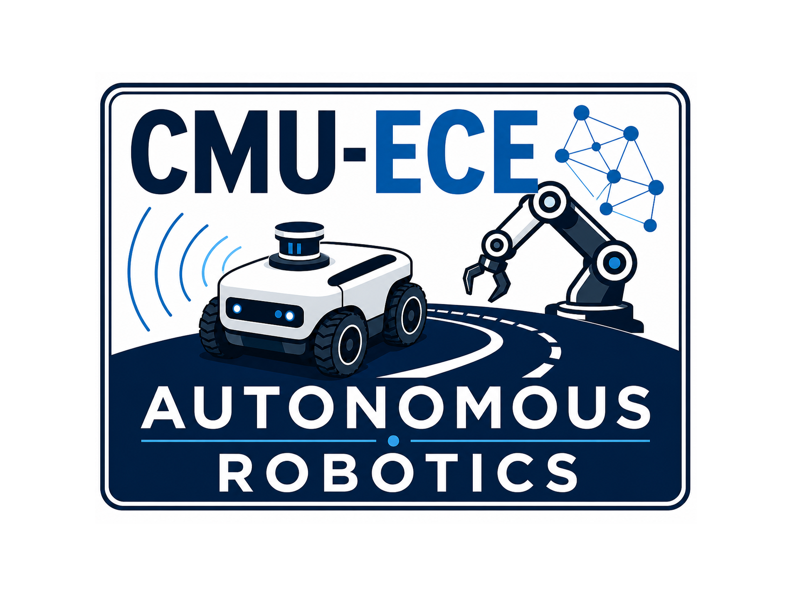

  

<h1 align="center">Autonomous Robotics II</h1>

  Carnegie Mellon University · Electrical and Computer Engineering · Fall 2026 
  Instructor: Prof. Ziad Youssfi

---

For most of their history, robots have been programmed with explicit rules: e.g., move the arm x degrees to the left, z degrees down, and close the gripper. That works on a factory line where nothing changes, but the moment a part is out of place, it fails. Today, a robot can be taught a task in an afternoon of showing, recognize objects, follow instructions it was never shown, and can keep improving on its own. This course is about how that works and what the limits are.

The course follows three ideas:

- **Copying:** record a person doing the task through the robot, and train a model to reproduce the motion; it works, but the robot knows only what it has seen.
- **Generalizing:** start from an LLM that has already learned from the internet what things look like and what words mean, and attach it to the robot's motors; now the robot knows what a vial is before it has seen one, though it can still only move in ways it was shown.
- **Rewarding:** let the robot try, tell it when it succeeded, and let it improve from its own attempts.

Today, robot learning policies are a hundred times smaller than what used to be just a couple of years ago. New robotic arms can be 3D printed to reduce cost. Thus, a team of students with a desktop PC can collect its own data, train open-source policies, and get real answers in a semester about which policies work best for which tasks.
